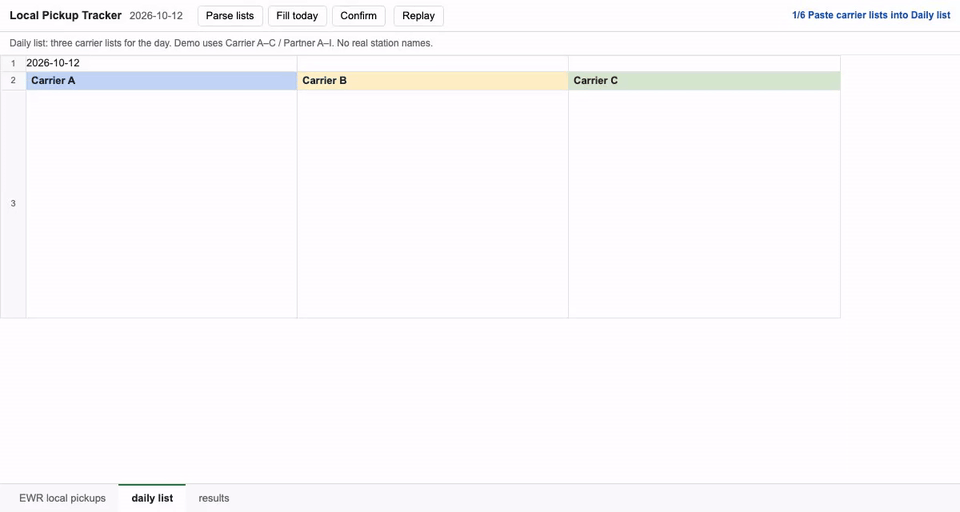

# Local Pickup Tracker

A structured database behind a web interface, replacing scattered spreadsheets where no one knew which mapping data was accurate and up to date. It runs a daily pickup desk for 150+ partners and 1,500+ trips, supporting $430k in monthly operations. It splits each carrier's list into trips, matches nicknames to official stations, fills the day's log, and prices each run from a database of carriers, stations and rates.

The tracker parses jobs and official station names, fills today’s log one partner per row, then confirms address, state, and price. Shared trucks use the shared rate; solo trucks use the solo rate.

## About

Sanitized public demo. Names are Partner A / Carrier A. Process logic only, no live data.

- [About page](https://yxwvwxy.github.io/pickup-database/)
- [Interactive demo](https://yxwvwxy.github.io/pickup-database/mock/demo-playback.html)
- [Demo clip](docs/demo.md)

